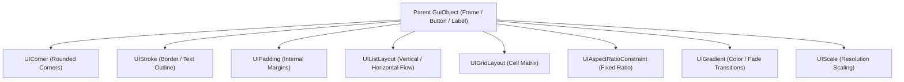

# Available Elements Reference — Visual Luau Compiler

This document provides an exhaustive, authoritative catalog of all **classes, instances, GUI components, UI modifiers, lighting objects, and services** implemented and available in the **Visual Luau Compiler** project.

---

## Table of Contents
1. [Master Elements Directory](#1-master-elements-directory)
2. [3D Objects & Spatial Primitives](#2-3d-objects--spatial-primitives)
3. [Scripts & Execution Units](#3-scripts--execution-units)
4. [2D & 3D User Interface (GUI Elements)](#4-2d--3d-user-interface-gui-elements)
5. [UI Modifiers & Constraints](#5-ui-modifiers--constraints)
6. [Lighting & Environmental Effects](#6-lighting--environmental-effects)
7. [Networking & Remotes](#7-networking--remotes)
8. [DataModel Container Services](#8-datamodel-container-services)
9. [Engine Utility Services](#9-engine-utility-services)
10. [Datatypes & Enums Reference](#10-datatypes--enums-reference)

---

## 1. Master Elements Directory

| Class Name | Category | `Instance.new()` | Viewport Render | Properties Panel | Description |
| :--- | :--- | :---: | :---: | :---: | :--- |
| **Part** | 3D Geometry | ✅ | ✅ (Three.js) | ✅ | Core 3D primitive (Block, Ball, Cylinder). Physics simulated. |
| **SpawnLocation** | 3D Geometry | ✅ | ✅ (Three.js) | ✅ | Spawn point for character / player origin. |
| **Model** | Hierarchy | ✅ | ✅ (Group) | ✅ | Hierarchical grouping with optional `PrimaryPart`. |
| **Folder** | Hierarchy | ✅ | ❌ (Logical) | ✅ | Organizational folder for scripts, assets, and parts. |
| **Decal** | Surface Appearance | ✅ | ✅ (Texture) | ✅ | Projected 2D texture applied to a specific part face. |
| **Texture** | Surface Appearance | ✅ | ✅ (Tiled) | ✅ | Repeating 2D texture with custom U/V tiling & offset. |
| **Camera** | Viewport | ✅ | ✅ (Perspective)| ✅ | Viewport perspective camera with CFrame and FieldOfView. |
| **Terrain** | 3D World | ✅ | ✅ (Mesh) | ✅ | Voxel / geometric terrain foundation. |
| **Script** | Code Execution | ✅ | ❌ | ✅ | Server-side script running in the Server VM. |
| **LocalScript** | Code Execution | ✅ | ❌ | ✅ | Client-side script running in the Client VM. |
| **ModuleScript** | Code Execution | ✅ | ❌ | ✅ | Reusable module cached and returned by `require()`. |
| **ScreenGui** | 2D GUI Container | ✅ | ✅ (Overlay) | ✅ | Root 2D layer collector displayed on player screens. |
| **SurfaceGui** | 3D GUI Container | ✅ | ✅ (Canvas) | ✅ | 2D GUI projected onto a 3D Part's face. |
| **BillboardGui** | 3D GUI Container | ✅ | ✅ (Facing) | ✅ | Floating GUI that always rotates to face the active camera. |
| **Frame** | GUI Element | ✅ | ✅ (DOM) | ✅ | Standard rectangular 2D container element. |
| **ScrollingFrame**| GUI Element | ✅ | ✅ (DOM) | ✅ | Scrollable container with independent CanvasSize and scrollbars. |
| **TextLabel** | GUI Element | ✅ | ✅ (DOM) | ✅ | Displays styled, wrapped, formatted or rich text. |
| **TextButton** | GUI Element | ✅ | ✅ (DOM) | ✅ | Interactive clickable button with text labels. |
| **TextBox** | GUI Element | ✅ | ✅ (DOM) | ✅ | Editable text input field with focus signals. |
| **ImageLabel** | GUI Element | ✅ | ✅ (DOM) | ✅ | Displays web or rbxasset images with slicing and scaling. |
| **ImageButton** | GUI Element | ✅ | ✅ (DOM) | ✅ | Interactive clickable button rendering an image. |
| **UICorner** | UI Modifier | ✅ | ✅ (BorderRadius)| ✅ | Rounds corners of any parent GUI element using UDim. |
| **UIStroke** | UI Modifier | ✅ | ✅ (Outline) | ✅ | Adds border outlines or text stroke effects. |
| **UIPadding** | UI Modifier | ✅ | ✅ (Padding) | ✅ | Adds internal padding (top, bottom, left, right) to parent GUI. |
| **UIListLayout** | UI Constraint | ✅ | ✅ (Flexbox) | ✅ | Orders children automatically in a horizontal or vertical list. |
| **UIGridLayout** | UI Constraint | ✅ | ✅ (CSS Grid) | ✅ | Arranges children into uniform cells with custom padding. |
| **UIAspectRatioConstraint** | UI Constraint | ✅ | ✅ (Ratio) | ✅ | Enforces fixed aspect ratios across dynamic screen sizes. |
| **UISizeConstraint** | UI Constraint | ✅ | ✅ (Min/Max) | ✅ | Clamps parent GUI minimum and maximum pixel bounds. |
| **UITextSizeConstraint** | UI Constraint | ✅ | ✅ (Font Clamp)| ✅ | Clamps minimum and maximum scalable font sizes. |
| **UIGradient** | UI Modifier | ✅ | ✅ (Gradient) | ✅ | Applies smooth linear color and transparency transitions. |
| **UIScale** | UI Modifier | ✅ | ✅ (Scale) | ✅ | Multiplies scale of parent GUI and all descendants uniformly. |
| **UIPageLayout** | UI Constraint | ✅ | ✅ (Pagination)| ✅ | Paginates child elements with animated page transitions. |
| **UIFlexItem** | UI Constraint | ✅ | ✅ (Flex Grow) | ✅ | Controls flex grow, shrink, and alignment inside layouts. |
| **PointLight** | Lighting | ✅ | ✅ (Omni Light)| ✅ | Emits omnidirectional spherical light from a part. |
| **SpotLight** | Lighting | ✅ | ✅ (Cone Light)| ✅ | Emits focused cone light along a specific face vector. |
| **SurfaceLight** | Lighting | ✅ | ✅ (Face Light)| ✅ | Emits soft directional light projecting from a part face. |
| **Sky** | Environment | ✅ | ✅ (Skybox) | ✅ | 6-sided cubic skybox textures, sun/moon, and stars. |
| **Atmosphere** | Environment | ✅ | ✅ (Fog & Haze)| ✅ | Realistic Rayleigh scattering, haze, glare, and horizon decay. |
| **ColorCorrectionEffect** | Post-Processing | ✅ | ✅ (Color Filter)| ✅ | Adjusts scene Brightness, Contrast, Saturation, and TintColor. |
| **BloomEffect** | Post-Processing | ✅ | ✅ (Glow Shader)| ✅ | Creates glowing halos around intense light sources. |
| **SunRaysEffect** | Post-Processing | ✅ | ✅ (God Rays) | ✅ | Volumetric sun ray streaks radiating from the sun. |
| **BlurEffect** | Post-Processing | ✅ | ✅ (Screen Blur)| ✅ | Gaussian screen blur effect. |
| **DepthOfFieldEffect** | Post-Processing | ✅ | ✅ (DoF Blur) | ✅ | Simulates camera focal blur outside the focus distance. |
| **RemoteEvent** | Networking | ✅ | ❌ | ✅ | Asynchronous cross-VM client/server messaging. |
| **RemoteFunction** | Networking | ✅ | ❌ | ✅ | Synchronous two-way request/response remote calls. |

---

## 2. 3D Objects & Spatial Primitives

### `Part`
The fundamental 3D building block in the workspace.
- **Shapes**: `Block`, `Ball`, `Cylinder`.
- **Materials**: `Plastic`, `SmoothPlastic`, `Neon` (glows with Bloom), `Metal`, `Glass`, `Wood`, `WoodPlanks`, `CorrodedMetal`, `DiamondPlate`, `Foil`, `Grass`, `Ice`, `Brick`, `Sand`, `Fabric`, `Granite`, `Marble`.
- **Physical Properties**:
  - `Anchored`: When `false`, the 3D physics engine simulates gravity, mass, linear velocity, angular velocity, friction, restitution, and collisions.
  - `CanCollide`, `CanTouch`, `CanQuery`, `Massless`.
  - `Size`: `Vector3.new(x, y, z)`.
  - `Position`: `Vector3.new(x, y, z)`.
  - `CFrame`: Full 4x4 spatial transform matrix (position + 3D orientation).
  - `Color` / `BrickColor`: Surface color tint.
  - `Transparency` (0 to 1), `Reflectance` (0 to 1).

### `SpawnLocation`
Inherits all properties of `Part`, acting as the designated spawn origin for player characters.

### `Model`
A container for grouping multiple 3D parts and sub-assemblies.
- **Properties**: `PrimaryPart` (`Part` instance).
- **Methods**: `:GetBoundingBox()`, `:MoveTo(position)`, `:SetPrimaryPartCFrame(cf)`.

### `Folder`
A purely logical container used to organize scripts, remotes, configurations, and models without introducing spatial transforms.

### `Decal` & `Texture`
Surface appearance objects parented to a `Part`.
- **Properties**:
  - `Texture`: Image URL or asset ID.
  - `Face`: `Front`, `Back`, `Top`, `Bottom`, `Left`, `Right`.
  - `Transparency`: 0 to 1.
  - `StudsPerTileU`, `StudsPerTileV`, `OffsetStudsU`, `OffsetStudsV` *(Texture only)*.

---

## 3. Scripts & Execution Units

| Script Type | Target Environment | Global Context | Characteristics |
| :--- | :--- | :--- | :--- |
| **`Script`** | Server VM | `game.ServerScriptService`, `game.ServerStorage` | Executes server logic. Has access to `RemoteEvent.OnServerEvent` and can call `:FireClient()` / `:FireAllClients()`. |
| **`LocalScript`** | Client VM | `game.Players.LocalPlayer`, `PlayerGui`, `UserInputService` | Executes client logic. Reacts to user clicks, keyboard events, and can call `:FireServer()`. |
| **`ModuleScript`** | Shared | Loaded via `require(moduleInstance)` | Pure Lua table or function definition cached upon first invocation. Reusable across both client and server scripts. |

---

## 4. 2D & 3D User Interface (GUI Elements)

### Layer Collectors (Roots)
- **`ScreenGui`**: Parented to `StarterGui` or `PlayerGui`. Renders directly as a 2D screen HUD.
  - *Properties*: `Enabled`, `IgnoreGuiInset`, `ResetOnSpawn`, `DisplayOrder`, `ZIndexBehavior`.
- **`SurfaceGui`**: Projected onto a face of a 3D `Part`.
  - *Properties*: `Adornee`, `Face`, `CanvasSize`, `PixelsPerStud`, `LightInfluence`, `AlwaysOnTop`.
- **`BillboardGui`**: Floats in 3D space above a part, always facing the camera.
  - *Properties*: `Adornee`, `Size`, `StudsOffset`, `AlwaysOnTop`, `MaxDistance`, `DistanceLowerLimit`, `DistanceUpperLimit`.

### Core 2D Elements
- **`Frame`**: Basic rectangular division.
- **`ScrollingFrame`**: Scrollable container with `CanvasSize`, `CanvasPosition`, `ScrollBarThickness`, and `AutomaticCanvasSize`.
- **`TextLabel` / `TextButton` / `TextBox`**: Text rendering with `Text`, `TextColor3`, `TextSize`, `Font`, `TextScaled`, `TextWrapped`, `RichText`, and alignment.
- **`ImageLabel` / `ImageButton`**: Image display with `Image`, `ImageColor3`, `ScaleType` (`Stretch`, `Slice`, `Tile`, `Fit`), `SliceScale`, and `TileSize`.

---

## 5. UI Modifiers & Constraints

UI Modifiers enhance and control the layout of GUI elements automatically:

- **`UICorner`**: `CornerRadius` (`UDim`).
- **`UIStroke`**: `Thickness`, `Color`, `Transparency`, `ApplyStrokeMode` (`Border`, `Contextual`), `LineJoinMode`.
- **`UIPadding`**: `PaddingTop`, `PaddingBottom`, `PaddingLeft`, `PaddingRight` (`UDim`).
- **`UIListLayout`**: `FillDirection`, `HorizontalAlignment`, `VerticalAlignment`, `Padding`, `SortOrder`.
- **`UIGridLayout`**: `CellSize` (`UDim2`), `CellPadding`, `StartCorner`, `FillDirectionMaxCells`.
- **`UIAspectRatioConstraint`**: `AspectRatio`, `AspectType`, `DominantAxis`.
- **`UISizeConstraint`**: `MinSize`, `MaxSize` (`Vector2`).
- **`UITextSizeConstraint`**: `MinTextSize`, `MaxTextSize`.
- **`UIGradient`**: `Color`, `Transparency`, `Rotation`, `Offset`.
- **`UIScale`**: `Scale` (multiplier factor).
- **`UIPageLayout`**: `Animated`, `Circular`, `EasingStyle`, `EasingDirection`, `TweenTime`.
- **`UIFlexItem`**: `FlexMode`, `ItemLineAlignment`, `GrowRatio`, `ShrinkRatio`.

---

## 6. Lighting & Environmental Effects

Parented inside `game.Lighting`:

### Lights
- **`PointLight`**: `Brightness`, `Color`, `Range`, `Shadows`, `Enabled`.
- **`SpotLight`**: `Angle`, `Face`, `Brightness`, `Color`, `Range`, `Shadows`, `Enabled`.
- **`SurfaceLight`**: `Face`, `Angle`, `Brightness`, `Color`, `Range`, `Shadows`, `Enabled`.

### Environment
- **`Sky`**: `SkyboxBk`, `SkyboxDn`, `SkyboxFt`, `SkyboxLf`, `SkyboxRt`, `SkyboxUp`, `SunTextureId`, `MoonTextureId`, `SunAngularSize`, `MoonAngularSize`, `CelestialBodiesShown`, `StarCount`.
- **`Atmosphere`**: `Density`, `Offset`, `Decay`, `Glare`, `Haze`.

### Post-Processing Shaders
- **`BloomEffect`**: `Intensity`, `Size`, `Threshold`.
- **`BlurEffect`**: `Size` (pixels).
- **`ColorCorrectionEffect`**: `Brightness`, `Contrast`, `Saturation`, `TintColor`.
- **`SunRaysEffect`**: `Intensity`, `Spread`.
- **`DepthOfFieldEffect`**: `FarIntensity`, `FocusDistance`, `InFocusRadius`, `NearIntensity`.

---

## 7. Networking & Remotes

Enables communication across the dual-runtime boundary (Server VM ↔ Client VM):

### `RemoteEvent`
One-way event triggering:
- **Server Script**:
  - `event:FireClient(player, ...)`
  - `event:FireAllClients(...)`
  - `event.OnServerEvent:Connect(function(player, ...) end)`
- **LocalScript**:
  - `event:FireServer(...)`
  - `event.OnClientEvent:Connect(function(...) end)`

### `RemoteFunction`
Two-way request/response invoking:
- **Server Script**:
  - `func.OnServerInvoke = function(player, ...) return result end`
  - `result = func:InvokeClient(player, ...)`
- **LocalScript**:
  - `result = func:InvokeServer(...)`
  - `func.OnClientInvoke = function(...) return result end`

---

## 8. DataModel Container Services

Root service nodes available in the Explorer hierarchy via `game:GetService("ServiceName")` or `game.ServiceName`:

1. **`Workspace`** (`workspace`): Holds all physical 3D parts, models, terrain, and camera.
2. **`Lighting`**: Controls global clock time, fog, shadows, ambient lighting, and sky effects.
3. **`ReplicatedStorage`**: Replicated to both server and client; ideal for shared modules, configurations, and remotes.
4. **`ServerScriptService`**: Secure server container for `Script` execution; client has zero access.
5. **`ServerStorage`**: Server-only asset and template storage.
6. **`StarterGui`**: Cloned into each player's `PlayerGui` on join/spawn.
7. **`StarterPlayer`**: Houses `StarterPlayerScripts` and `StarterCharacterScripts`.
8. **`StarterPack`**: Tools and items equipped to players.
9. **`SoundService`**: Global audio settings and listener positioning.
10. **`Teams`**: Manages player team assignments and friendly fire.
11. **`MaterialService`**: Custom material overrides and physical definitions.

---

## 9. Engine Utility Services

| Service Name | Description | Key Methods & Events |
| :--- | :--- | :--- |
| **`TweenService`** | Smooth parameter interpolation | `:Create(instance, tweenInfo, { Property = target })`, `:Play()`, `:Pause()`, `:Cancel()`. |
| **`RunService`** | Frame-by-frame loop events | `.Heartbeat`, `.RenderStepped`, `.Stepped`, `:IsServer()`, `:IsClient()`, `:IsStudio()`. |
| **`UserInputService`** | Client input polling | `.InputBegan`, `.InputEnded`, `.MouseMoved`, `:IsKeyDown(keyCode)`. |
| **`CollectionService`** | Tag-based entity management | `:AddTag(inst, tag)`, `:RemoveTag(inst, tag)`, `:HasTag(inst, tag)`, `:GetTagged(tag)`. |
| **`Debris`** | Garbage collection timed cleanup | `:AddItem(instance, lifetimeSeconds)`. |
| **`HttpService`** | Data serialization & UUIDs | `:JSONEncode(tbl)`, `:JSONDecode(jsonStr)`, `:GenerateGUID(wrapInBraces)`. |
| **`PathfindingService`** | Navigation mesh path calculation | `:CreatePath(options)`, `path:ComputeAsync(start, target)`. |
| **`ContextActionService`** | Action-to-key binding manager | `:BindAction(name, callback, createTouchBtn, ...keys)`, `:UnbindAction(name)`. |
| **`Players`** | Player list and local player | `.LocalPlayer`, `:GetPlayers()`, `.PlayerAdded`, `.PlayerRemoving`. |
| **`TeleportService`** | Place teleportation mock | `:Teleport(placeId, player)`. |
| **`MarketplaceService`** | Developer product & gamepass API | `:PromptPurchase(player, assetId)`, `:UserOwnsGamePassAsync(userId, passId)`. |

---

## 10. Datatypes & Enums Reference

Available in the Lua execution environment without imports:

- **`Vector3`**: `Vector3.new(x, y, z)`, `Vector3.zero`, `Vector3.one`, `:Dot(v)`, `:Cross(v)`, `:Lerp(v, alpha)`, `.Magnitude`, `.Unit`.
- **`Vector2`**: `Vector2.new(x, y)`, `Vector2.zero`, `.Magnitude`.
- **`CFrame`**: `CFrame.new(...)`, `CFrame.Angles(rx, ry, rz)`, `CFrame.lookAt(eye, target)`, `:Inverse()`, `:Lerp(target, alpha)`, `.Position`, `.LookVector`, `.RightVector`, `.UpVector`.
- **`Color3`**: `Color3.new(r, g, b)`, `Color3.fromRGB(r, g, b)`, `Color3.fromHSV(h, s, v)`, `Color3.fromHex(hex)`, `:Lerp(c, alpha)`.
- **`BrickColor`**: `BrickColor.new(nameOrIndex)`, `BrickColor.random()`, predefined colors (`Red`, `Blue`, `White`, etc.).
- **`UDim`**: `UDim.new(scale, offset)`.
- **`UDim2`**: `UDim2.new(xScale, xOffset, yScale, yOffset)`, `UDim2.fromScale(x, y)`, `UDim2.fromOffset(x, y)`.
- **`TweenInfo`**: `TweenInfo.new(time, easingStyle, easingDirection, repeatCount, reverses, delayTime)`.
- **`NumberRange`**: `NumberRange.new(min, max)`.
- **`ColorSequence`** & **`NumberSequence`**: Multi-keypoint sequence definitions.
- **`Enum`**: `Enum.Material`, `Enum.EasingStyle`, `Enum.EasingDirection`, `Enum.Font`, `Enum.ScaleType`, `Enum.FillDirection`, `Enum.ApplyStrokeMode`, `Enum.SortOrder`, `Enum.StartCorner`, `Enum.AutomaticSize`, `Enum.SizeConstraint`, etc.
